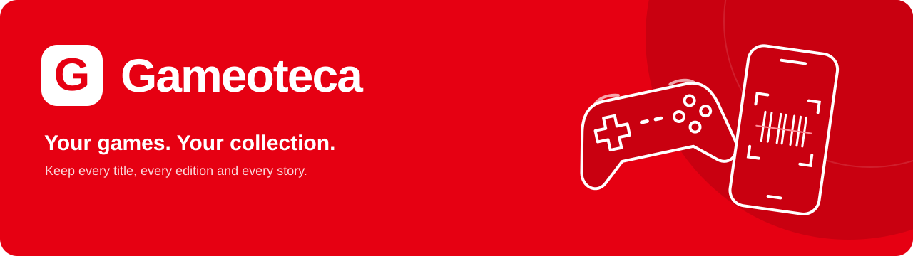
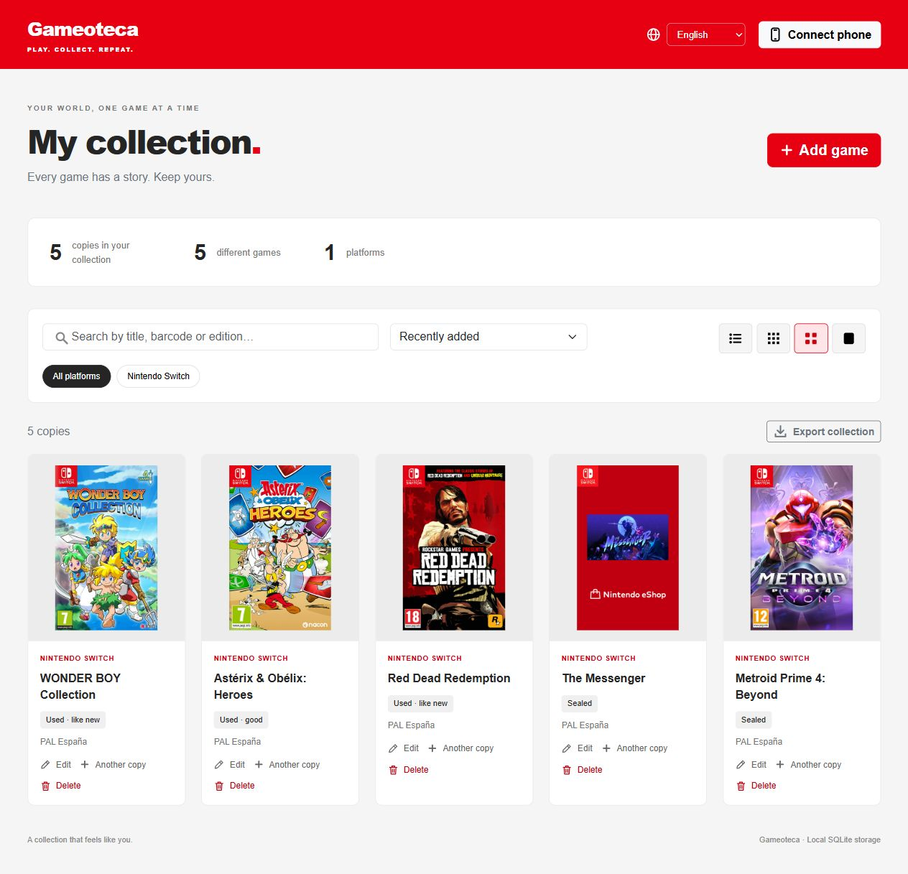
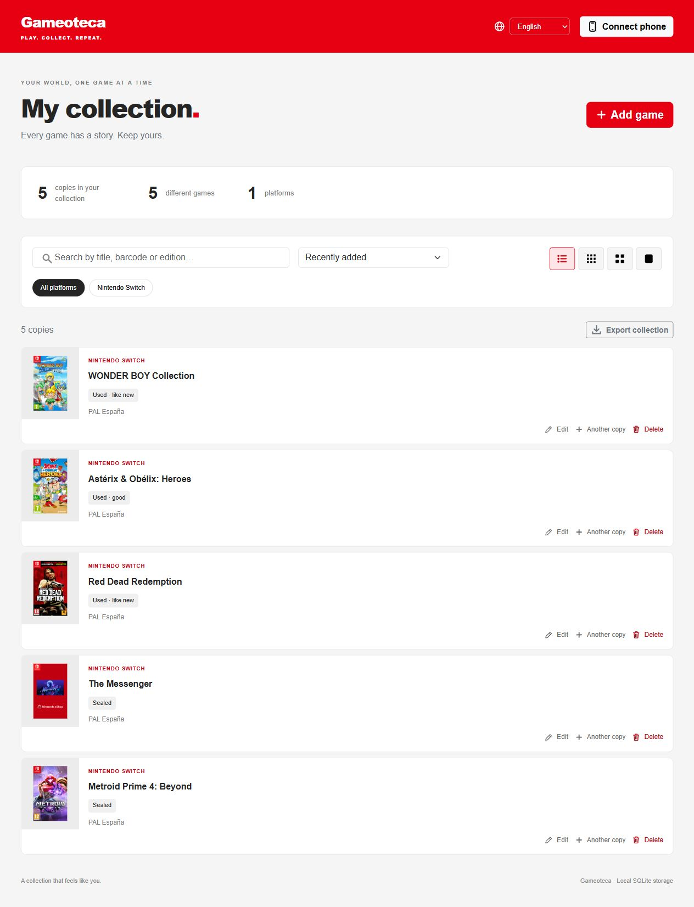
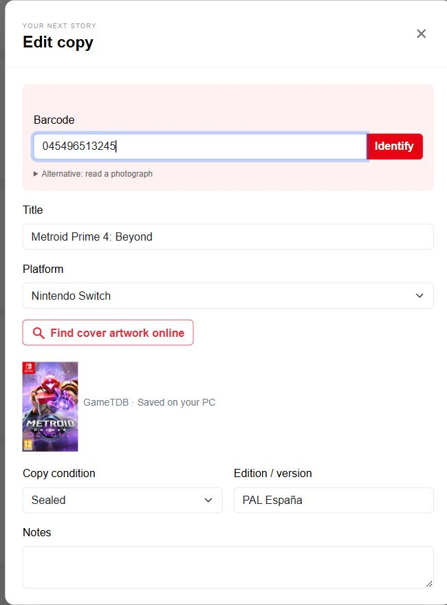
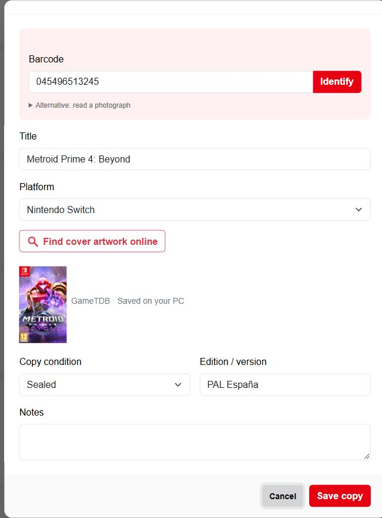
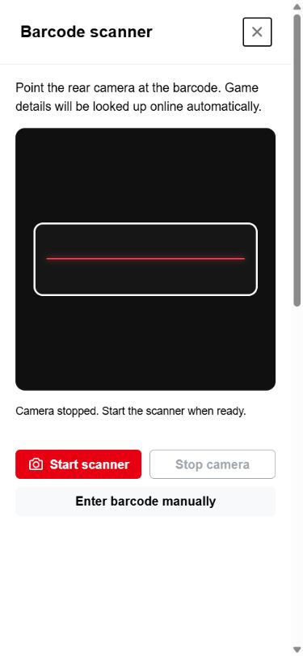

# Gameoteca

A Node.js game collection app with integrated SQLite, an Electron desktop app for Windows, local mobile scanning and a responsive Bootstrap interface.

Open source under the [MIT License](LICENSE). Third-party libraries and downloaded game artwork retain their own licenses and rights; see [third-party notices](THIRD_PARTY_NOTICES.md).

## Download for Windows

Download the installer or portable executable from [GitHub Releases](https://github.com/josemorant/gameoteca/releases/latest). Windows builds include Node.js; no separate installation is required. The executables are currently unsigned.

## Run

Requires Node.js 22.13+ and npm.

```powershell
npm ci
npm start
```

Open http://localhost:3210. Run `npm run desktop` for the desktop window.

## How to use Gameoteca

### Browse your collection

Switch between **List**, **Small tiles**, **Medium tiles** and **Large tiles**. Search by title, barcode or edition, select one or more platforms, and sort by title, platform, condition or date added.



Use **List** for a compact view of each game's condition and edition. **Export collection** saves the collection records as JSON; see [Data and backup](#data-and-backup) for a complete backup including images.



### Add a game and manage physical copies

Choose **Add game**, enter a barcode and select **Identify**, or enter the title and platform yourself. Use **Find cover artwork online** to select artwork when needed. Existing copies open with **Edit**.



Scroll down to choose the physical copy's **Copy condition**, **Edition / version** and **Notes**, then select **Save copy**. Use **Another copy** on a game card to add a second physical item with its own condition, edition and notes.



### Scan from your phone

Choose **Connect phone** on the PC and follow the [mobile connection steps](#mobile-connection): scan the QR, trust the PC's local certificate on first use and enter the four-digit PIN. On the phone, tap **Start scanner** and point the rear camera at a barcode. Identified game details and available artwork are filled automatically; review the copy details and save.

<p align="center"></p>

The mobile screenshot shows the scanner before camera activation. Screenshots use a collection shared by the author; personal notes, pairing codes and network addresses are omitted. Game artwork remains the property of its respective rights holders.

## Languages

English is the default. The language selector supports English, Spanish, Catalan, French and German. Each browser remembers its choice. A language selector is also available on the phone pairing screen.

Interface labels, conditions, messages, accessible labels and errors are translated. Game titles, user notes, editions and platform names are collection data and remain as entered. Conditions use stable database identifiers. Older Spanish condition labels migrate automatically while preserving the copies.

## Mobile connection

1. Start Gameoteca on the PC and choose **Connect phone**.
2. Connect the phone to the same Wi-Fi.
3. Scan the QR code to open the mobile HTTPS setup guide.
4. On first use, download and manually trust this PC's local CA certificate on the phone. Compare its SHA-256 fingerprint with the PC. No certificates are installed automatically.
5. Open the **secure scanner**, enter the **four-digit PIN**, and tap **Start scanner** to allow camera access.
6. Point the rear camera at an EAN/UPC barcode. The app looks up the title and platform online and downloads available artwork automatically.
7. Review the physical copy's condition and save. Scan mode then offers to scan the next game.

The QR contains only the HTTP setup URL, not the PIN. It is generated locally; no QR service receives the PC address. Each local IPv4 interface has its own QR. The connection panel also provides the direct HTTPS scanner URL for subsequent use.

The PIN changes when the server restarts. Five failed attempts block an address for five minutes. There is also a global limit of forty failed attempts in five minutes. A successful pairing issues an internal session token valid for twelve hours; the four digits are not used directly as credentials for collection requests. PINs, QR controls and PC network addresses are not exposed to remote API clients.

Allow Gameoteca through Windows Firewall on **private networks**. Keep the PC on. The desktop catalog and onboarding use HTTP port `3210`; the live mobile scanner uses HTTPS port `3211`. Do not forward these ports on the router. `PORT` and `HTTPS_PORT` override them. If the PC's network address changes, restart Gameoteca to renew the server certificate for the new address.

Live decoding runs on the phone using its native BarcodeDetector when available, or bundled ZXing as a fallback. The camera feed is not uploaded: only the detected barcode is sent to the PC. EAN-13, EAN-8, UPC-A and UPC-E are supported, with checksum validation and duplicate-frame suppression. Camera tracks stop when a code is detected, the scanner is closed or the page goes into the background. Manual input and photo reading remain optional alternatives.

The PC generates a private CA and server certificates locally in the data folder's `tls/` directory. Only the public CA certificate is downloadable. The phone must explicitly trust it before live scanning over HTTPS works. See the [mobile scanner guide](docs/MOBILE_SCANNER.md). Physical Android/iOS camera and certificate-installation tests are still pending.

## Collection and artwork

- Independent copies with a condition, edition and notes for each physical item.
- List, small, medium and large tiles.
- Title, platform, condition and recent sorting; multiple-platform filters and text search.
- “Another copy” reuses the game details. Copies of the same title/platform/barcode share artwork.
- JSON export of the collection. Images are separate files; there is no JSON importer.
- Artwork searches combine Libretro Thumbnails, GameTDB for Switch and a public retail catalogue for supported modern platforms. GameTDB downloads its title index once and caches it for 24 hours; missing regional artwork falls back to EN/US.
- Set `THEGAMESDB_API_KEY` to add TheGamesDB to the available sources. Its failure does not block the other sources.
- Barcode identification uses internet providers only: UPCitemdb, followed by an exact EAN check against the alternative retail catalogue when necessary. Existing collection records are not used as identification results. Recent successful responses are cached in memory for ten minutes. UPC/EAN forms with leading zeroes are treated as equivalent during lookup.
- Title and platform are filled automatically where unambiguous. Trusted artwork supplied by the barcode provider is downloaded automatically; otherwise the app looks for an exact title/platform match in the artwork providers. Missing artwork or an uncertain platform stays available for review. Provider coverage is not universal.
- Dedicated GameTDB front covers are preferred over retail product photos for Switch matches, avoiding large white margins in the collection grid.

For saved games without an image, use **Fetch cover** on the game card to repair only the artwork while preserving each copy's condition, edition and notes.

See [provider analysis](docs/FUENTES.md) and the [EmulationStation / EmuDeck / homebrew comparison](docs/EMULATION_SOURCES.md). ScreenScraper and SteamGridDB are documented options, not active integrations without their required credentials. Coverage depends on the catalogue and edition.

## Windows release

```powershell
npm run dist:win
npm run verify:package
```

Builds an NSIS installer and portable x64 executable in the **same `release/` folder**. The build script checks its target paths and removes previous build outputs from `release/`, `dist/` and `release-icons/` before compiling. Do not use version-specific output directories. Collection data is never removed by a build.

The first build may download Electron and packaging tools. Windows users do not need a separate Node.js installation. The executables are unsigned, so Windows may display SmartScreen.

The desktop identity and user-data location remain compatible with previous releases. Website and application icons are in `public/icons/` and `build/gameoteca.ico`. The original interface SVG symbol set is `public/ui-icons.svg`.

## Data and backup

Server mode stores `data/catalog.sqlite` and `data/covers/`; `DATA_DIR` overrides the folder. Desktop mode uses the `data` subfolder of Electron's `userData` directory under the user's app-data folder, outside the executable.

Close the application and copy the **entire data folder**, including covers, for a complete backup. Restore with the app closed. SQLite uses WAL; copying only the main database while it is being written is not a complete backup.

## Checks

`npm test` checks persistence, independent copies, migration, API validation, pairing limits, QR decoding, remote authentication, translations, real EAN image decoding, camera lifecycle/cancellation with simulated streams, online-only identification and verified HTTPS connections. `npm run verify:package` checks packaged dependencies, scanner code, TLS support, translations and icons.

See [validation notes](docs/VALIDACION.md) and [1.3.0 changes](docs/RELEASE.md).

## Contributing and branches

See [CONTRIBUTING.md](CONTRIBUTING.md) for setup, checks and the branch workflow. `main` contains stable releases; `develop` integrates changes. Create `feature/*` and `fix/*` branches from `develop`, then open a pull request. Release tags use `v<package-version>` on `main`.

CI runs the tests on pull requests and verifies Windows packaging on `main` and `develop`. Build outputs, local collections, certificates, downloaded artwork and development tools are excluded from Git.
